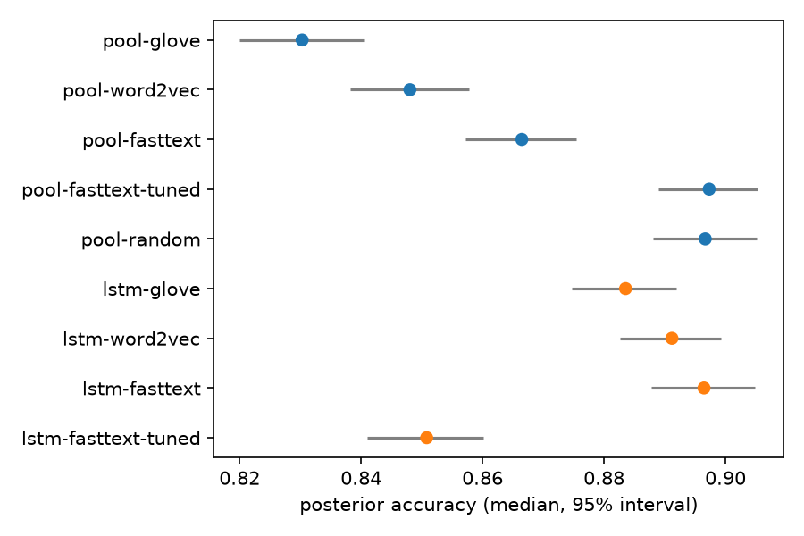
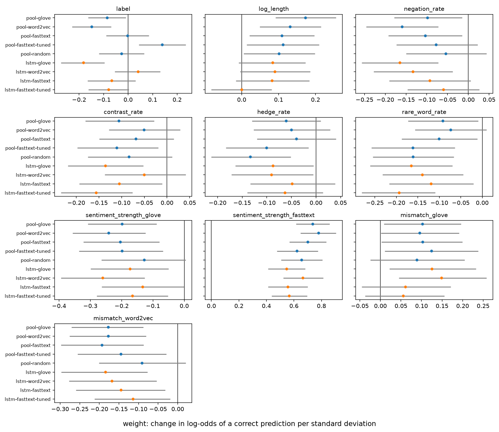

# Task 6: Which reviews does each design choice get right?

Nov 22, 2026 · @Stephen

> **This folder is ours.** Everything in `part2/task6_error_analysis/` was added by us for Task 6. The BDA model itself is the course's, in `part2/analysis.py`. How to run it is in [README.md](README.md).

## The short version

We fitted one Bayesian model that predicts, for every review and every system, whether that system classified the review correctly. We did this for 9 systems and 10 review features. It answers two questions at once: **is one design choice really better than another**, and **on which kinds of reviews**.

- **The design choices clearly differ in accuracy.**
  - fastText beats GloVe with both encoders.
  - Fine-tuning helps pooling but hurts the LSTM.
  - The LSTM beats pooling whenever the vectors are frozen.
- **Pretrained vectors don't matter for pooling once they are trained.** Random starting vectors do just as well: a 0.06-point gap, P = 0.54.
- **What makes a review hard is mostly the same for every system.**
  - Reviews with a clear sentiment signal are easy for everyone.
  - Rare words, negations and contrast words make everyone less accurate.
- **Most of our system-specific hypotheses were not supported.** In particular, the LSTM is *not* better than pooling on reviews with negations or contrast words, so **our features don't explain where the LSTM's advantage comes from**.

---

## What BDA is, in four steps

1. **Turn predictions into a table of right and wrong.** For every review and every system, one row: which system, whether it was correct (1 or 0), and the review's features.
2. **Fit a logistic regression on "correct?".** The chance that system *s* is right on review *n* is:

   `sigmoid( global_mean + sys_shift[s] + w[s] · features[n] )`

   Each system has its own shift (how good it is overall) and its own feature weights (what helps or hurts it).
3. **Make it Bayesian.**
   - A normal fit gives one value per weight. We want to know how *sure* we are, so we get a distribution of plausible values instead: the **posterior**.
   - Every weight starts with a Laplace(0, 1) prior, which assumes a feature doesn't matter until the data shows that it does.
4. **Draw samples with MCMC.**
   - The posterior can't be computed exactly. The integral that normalises it is intractable for 100 parameters: 1 global mean, 9 system shifts and 9 × 10 weights.
   - MCMC (the NUTS sampler) instead walks through parameter space, scoring each set of weights by prior × likelihood. Good sets get visited often. We keep 4 chains × 1,000 samples = **4,000 complete sets of weights**.

**Every claim below comes from counting samples.**
- "P(fastText more accurate than GloVe) = 0.98" means that in 98% of the 4,000 sets, fastText's accuracy was higher.
- A 95% interval is the middle 95% of the samples.
- We call a result *credible* when the 95% interval excludes 0. That is roughly the same as P > 0.975 or P < 0.025.

**Why not just compare accuracies?** A 0.6-point gap on 25,000 reviews might be luck: the particular reviews we happened to evaluate on. The BDA gives that uncertainty a number, and it tells us *where* systems differ, not only whether they do.

---

## Systems: the design choices we compare

All 9 systems use the same five folds (Part 1, seed 3) and training seed 0. Every LSTM is the untuned baseline (1 layer, 20 units), so each comparison changes one thing only.

| System | What it is | W&B run | Accuracy (25,000 reviews) |
|---|---|---|---:|
| pool-glove | Embed-and-pool, frozen GloVe | `dl4cj64u` | 83.09% |
| pool-word2vec | Embed-and-pool, frozen word2vec | `3ut26gpz` | 84.75% |
| pool-fasttext | Embed-and-pool, frozen fastText | `rsa2q3qs` | 86.74% |
| pool-fasttext-tuned | Embed-and-pool, fine-tuned fastText | `zr17jbgj` | 89.72% |
| pool-random | Embed-and-pool, random vectors trained from scratch (fastText's vocabulary) | `f774fbb1` | 89.63% |
| lstm-glove | LSTM, frozen GloVe | `7e5avnkt` | 88.06% |
| lstm-word2vec | LSTM, frozen word2vec | `3cwzsntd` | 88.82% |
| lstm-fasttext | LSTM, frozen fastText | `7h58qpb5` | 89.41% |
| lstm-fasttext-tuned | LSTM, fine-tuned fastText | `zxn1n2hg` | 84.81% |

| Design choice | Systems compared |
|---|---|
| Embedding source | glove vs word2vec vs fasttext, separately for each encoder |
| Freezing vs fine-tuning | fasttext vs fasttext-tuned, for each encoder (fine-tuning was only run with fastText) |
| Does pretraining matter? | pool-fasttext-tuned vs pool-random (pooling only) |
| Encoder | lstm-X vs pool-X, for each of the four embedding settings |

## Features: what describes each review

Every system sees the same 10 columns. Each is standardised, so a weight is the change in log-odds of a correct prediction per standard deviation of the feature. Before fitting, we wrote down what we expected each feature to show.

| Feature | Definition | What we expected |
|---|---|---|
| `label` | 1 = positive, 0 = negative | GloVe misses more positive reviews |
| `log_length` | log(number of words) | Long reviews dilute pooling's average and strain the LSTM's memory |
| `negation_rate` | *not, no, never, n't, cannot, nothing, nobody, none, neither, nor, without* per 100 words | Hurts pooling more than the LSTM, because averaging ignores word order |
| `contrast_rate` | *but, however, although, though, yet, despite, nevertheless* per 100 words | Mixed reviews hurt pooling more |
| `hedge_rate` | *somewhat, bit, almost, rather, fairly, slightly, kinda* per 100 words | Mild reviews are harder for everyone |
| `rare_word_rate` | Share of content words found in fewer than 20 of the 18,000 reviews the model trained on (its own fold) | Hurts random vectors more than pretrained ones |
| `sentiment_strength_glove`, `_fasttext` | How strongly the review's words lean positive or negative in that embedding (details below) | Weak GloVe signal explains GloVe's failures |
| `mismatch_glove`, `_word2vec` | How differently that embedding reads the review's words compared with fastText (details below) | Hurts GloVe models, and word2vec less, but not fastText |

**The two embedding features:**
- **Sentiment strength.**
  - In each embedding, the *sentiment direction* is the average vector of 1,744 positive words minus the average of 4,044 negative words. Both lists come from the Hu & Liu opinion lexicon in NLTK, restricted to words all three embeddings know.
  - Each word's score is its cosine with that direction. A review's strength is the absolute value of its average word score, centred so that the average IMDb word scores 0.
- **Meaning mismatch.**
  - For each of 12,958 common content words, we compare its 10 nearest neighbours in GloVe (or word2vec) with its 10 nearest neighbours in fastText.
  - A review's mismatch is the average share of neighbours that differ.
  - On average, **61% of a word's GloVe neighbours differ from its fastText neighbours, and 48% of its word2vec neighbours.** This puts a number on Task 2's observation that GloVe gives review words their news meanings.

**Design decisions:**
- **Word lists are rates, not counts.** Counts would mostly measure length again.
- **Content words exclude stop words and the word lists above.**
- **We dropped word2vec's sentiment strength.** It was 0.95 correlated with fastText's, so their weights couldn't be told apart. All remaining pairs correlate below 0.7; the largest is GloVe vs fastText strength, at 0.67.
- **The BDA uses a random subset of 5,000 reviews** (45,000 rows), to keep MCMC to a few minutes.

**Even before the BDA, GloVe's sentiment signal is the weakest.** The correlation between each embedding's signed sentiment reading and the true label:

| GloVe | word2vec | fastText |
|---:|---:|---:|
| 0.40 | 0.56 | 0.57 |

---

## Did MCMC work?

Yes, by every standard check:
- **0 divergences.**
- **Worst `r_hat` 1.0075.** Below 1.01 means the 4 chains agree.
- **Smallest effective sample size 543.**

If any of these had failed, the samples wouldn't describe the posterior and none of the results below could be trusted.

---

## Result 1: which design choices matter?

| Comparison | Accuracy difference | 95% interval | P(first is better) |
|---|---:|---:|---:|
| fastText vs GloVe, pooling | **+3.6 points** | +2.2 to +5.0 | 1.00 |
| word2vec vs GloVe, pooling | +1.8 | +0.4 to +3.2 | 0.995 |
| fastText vs word2vec, pooling | +1.8 | +0.4 to +3.2 | 0.997 |
| fastText vs GloVe, LSTM | **+1.3** | +0.1 to +2.5 | 0.98 |
| word2vec vs GloVe, LSTM | +0.8 | −0.5 to +2.0 | 0.90 |
| fastText vs word2vec, LSTM | +0.6 | −0.7 to +1.7 | 0.82 |
| Fine-tuned vs frozen fastText, pooling | **+3.1** | +1.9 to +4.3 | 1.00 |
| Fine-tuned vs frozen fastText, LSTM | **−4.6** | −5.8 to −3.2 | 0.00 |
| Fine-tuned fastText vs random vectors, pooling | **+0.06** | −1.1 to +1.3 | **0.54** |
| LSTM vs pooling, frozen GloVe | +5.3 | +3.9 to +6.7 | 1.00 |
| LSTM vs pooling, frozen word2vec | +4.3 | +3.0 to +5.6 | 1.00 |
| LSTM vs pooling, frozen fastText | +3.0 | +1.8 to +4.3 | 1.00 |
| LSTM vs pooling, fine-tuned fastText | −4.7 | −5.9 to −3.4 | 0.00 |

- **The embedding source matters most for pooling.** With the LSTM, only fastText vs GloVe is credible. The LSTM partly makes up for weaker vectors.
- **Fine-tuning flips sign between encoders.** Task 4 showed the fine-tuned LSTM overfitting: its validation loss doubled after epoch 4.
- **Pretraining makes no difference to trained pooling vectors.** With 18,000 training reviews per fold, vectors learned from scratch catch up completely. This confirms Task 3's 23-review gap and shows that it isn't hiding a difference.

## Result 2: which reviews are hard?

Each panel is one feature. Each line is one system: blue for pooling, orange for the LSTM. The dot is the median weight and the bar the 95% interval. Left of 0 means the feature lowers that system's chance of being right.

**Effects shared by all 9 systems:**

| Feature | Weights across systems | What it means |
|---|---|---|
| `sentiment_strength_fasttext` | **+0.55 to +0.78**, all credible | By far the strongest predictor. Reviews whose words clearly lean one way are easy for every model |
| `sentiment_strength_glove` | −0.13 to −0.26, credible for 7 of 9 (the other two intervals just reach 0) | Read together with fastText's. Holding fastText's reading fixed, sentiment that *only GloVe sees* makes reviews harder for every model, so it's probably noise from GloVe's news meanings |
| `rare_word_rate` | −0.07 to −0.19, credible for 8 of 9 | Rare words lower accuracy for everyone, even pretrained fastText |
| `negation_rate` | −0.05 to −0.16 | Negations lower accuracy for nearly every system, pooling *and* LSTM |
| `contrast_rate` | −0.05 to −0.16 | Same pattern as negations |
| `log_length` | 0.00 to +0.17 | Longer reviews are slightly *easier*, because they give more evidence. The fine-tuned LSTM doesn't benefit |
| `mismatch_glove`, `mismatch_word2vec` | about +0.1 and about −0.15 | Same direction for every system. They describe the review's vocabulary, not a weakness of one embedding |

**Our hypotheses, one by one:**

| Hypothesis | Result | Evidence |
|---|---|---|
| Negations hurt pooling more than the LSTM | **Not supported** | LSTM minus pooling negation weight: −0.07 to +0.03 across the four pairs, none credible |
| Contrast words hurt pooling more | **Not supported** | Differences −0.05 to 0.00, none credible |
| GloVe's weak sentiment signal explains GloVe's failures | **Partly** | GloVe's sentiment reading matches the labels worst (0.40). But the strength weight is the same for GloVe and fastText systems (difference −0.01, P = 0.47 for pooling) |
| GloVe's different word meanings hurt GloVe models | **Not supported** | No credible difference in `mismatch_glove` weights between GloVe and other systems |
| Rare words hurt random vectors more | **Not supported** | pool-random −0.16, pool-fasttext-tuned −0.16: difference 0.00, P = 0.50 |
| GloVe misses more positive reviews | **Supported for the LSTM** | lstm-glove label weight −0.18 vs lstm-word2vec +0.04 (P = 1.00); vs lstm-fasttext P = 0.96 |
| The fine-tuned LSTM fails across the board (overfitting) | **Mostly supported** | Lower everywhere, plus worse on positive reviews (−0.22 vs fine-tuned pooling, P = 0.00) and no benefit from length (P = 0.04) |

A few label effects we didn't predict:
- Fine-tuning helps pooling especially on **positive** reviews. Fine-tuned fastText's label weight is +0.14, against −0.00 frozen and −0.03 for random vectors (P = 0.99 against random).
- Frozen word2vec pooling does worse on positive reviews: −0.15.

## What it adds up to

- **Embedding quality acts like a global shift, not a review-specific one.** fastText beats GloVe by a similar amount on every kind of review we measured. GloVe's weaker sentiment signal (0.40 vs 0.57) is the most likely reason: it makes every review slightly harder to read, rather than hurting particular reviews.
- **The LSTM's advantage with frozen vectors is real (+3 to +5 points), but not where we expected.** It isn't concentrated on negations or contrast words. Something we didn't measure drives it.
- **Fine-tuning the LSTM's embeddings hurts everywhere.** That fits overfitting, which Task 4 saw directly in the validation loss, rather than one kind of review going wrong.
- **For pooling, pretrained vectors don't matter once they're trained** on 18,000 reviews.

## Limits

- **One training seed per system.** The intervals cover which reviews were sampled, not training randomness. Seeds 1–2 are queued (`part2/task5_seed_variance/seeds.sbatch`). When they finish, each configuration enters the BDA three times, and effects that don't repeat across seeds should be dropped.
- **5,000 of 25,000 reviews.** Larger subsets would narrow the intervals. The accuracy differences are already credible, but some feature differences might become credible with more data.
- **Some weights only make sense together.** The two sentiment-strength features (0.67 correlated) and the two mismatch features (0.48 correlated) are each read as a pair.
- **The model is linear on the log-odds scale.** A feature that only matters above some threshold would show up weakly.
- **Feature word lists are short and hand-chosen.** A missing effect may be a weak feature, not a missing effect.

---

## How this answers the notebook's questions

| The notebook asks | Our answer |
|---|---|
| What analysis features did you come up with? | Six text features (label, length, negations, contrast words, hedges, rare words) and two embedding features (sentiment strength, meaning mismatch), each tied to a hypothesis written down before fitting |
| Which ones did you manage to test, and how did that go? | All of them, on 9 systems at once. Sentiment strength and rare words predict errors strongly but equally for every system. The system-specific hypotheses mostly failed; see the hypothesis table |
| What would you prioritise in the future to improve your systems? | See below |
| (Task 5) Are you gathering enough information to substantiate your choices? | Accuracy gaps now come with probabilities. Seed reruns are queued to cover training randomness, which the BDA can't see |

**What we would prioritise next:**
1. **Find the source of the LSTM's advantage.** Test features that depend on word order beyond single words: where in the review the sentiment sits (a verdict at the end), or whether the sentiment flips between the first and second half.
2. **Deal with rare words.** They hurt every system, including pretrained fastText. Subword information (fastText's character n-grams for unseen words, or BPE from Part 1) is the obvious next step.
3. **Regularise fine-tuning in the LSTM** (word dropout, a lower learning rate for the embeddings) instead of giving it up. Fine-tuning gained 3 points for pooling.
4. **Test pretraining with less data.** With the half-data runs, we'd expect pretrained vectors to beat random ones; with 18,000 reviews they don't.

---

## Questions the TA will probably ask

**"What does the BDA tell you that comparing accuracies doesn't?"**
Two things: how sure we can be that a gap is real, and on which reviews systems differ. For example, word2vec vs GloVe with the LSTM is +0.8 points, but P = 0.90, so it's not credible. Pretrained vs random pooling is +0.06 with P = 0.54, so it's a coin flip.

**"Why Bayesian, and not sklearn's logistic regression?"**
sklearn gives one weight per feature with no uncertainty. We'd also want intervals on *derived* quantities: each system's accuracy and the difference between two systems. With samples, each of those is simply computed per sample. The most probable single set of weights under a Laplace prior is the same as L1-regularised logistic regression, so the Bayesian version adds the uncertainty without changing the model.

**"What is MCMC doing, and why is it needed?"**
It draws sets of weights in proportion to prior × likelihood, so plausible weights appear often. It's needed because the posterior's normalising integral, and every summary we want from it, is a 100-dimensional integral with no closed form. MCMC never computes that integral. Every answer becomes a count or an average over the samples.

**"How do you know MCMC worked?"**
Four chains from different starts agree (`r_hat` at most 1.0075), the sampler had no divergences, and every parameter has at least 543 effective samples.

**"Why does GloVe's sentiment strength have a *negative* weight? Shouldn't clear sentiment help?"**
It's read together with fastText's, which is 0.67 correlated with it. fastText's weight is strongly positive, so clear sentiment does help. GloVe's weight then measures sentiment that GloVe sees *beyond* what fastText sees. That extra reading is mostly noise from GloVe's news meanings, and it misleads every model.

**"Your hypothesis was that the LSTM handles negation better. Why didn't it show up?"**
The LSTM and pooling lose about the same accuracy per standard deviation of negation rate. Possible reasons:
- 20 hidden units may be too few to learn that *not* flips the next word.
- Negation rate counts negations but doesn't say whether they flip *sentiment* words. "Not bad" and "not until the end" count the same.
- The LSTM's gain may come from elsewhere, such as where in the review the sentiment sits.

That's our first priority for future work.

**"Is the sentiment-strength feature circular for pooling?"**
Partly, which is why we use strength (how much sentiment) and not the signed score (which direction). The direction comes from a fixed opinion lexicon, never from IMDb labels, and is the same for every system. Strength predicts errors equally for LSTM systems, which don't average vectors, so it isn't just reproducing pooling's computation.

**"Why measure mismatch against fastText?"**
fastText is the best frozen embedding, and in Task 2 it gave review words their review meanings. It's a reference point, not ground truth. That's why mismatch only exists for GloVe and word2vec.

**"Why did you drop word2vec's sentiment strength?"**
It was 0.95 correlated with fastText's. With both in, each system's two weights could trade off almost freely, and neither could be interpreted.

**"Why rates and not counts for negations?"**
Counts grow with length, so they would partly measure length again. Rates per 100 words separate "how many negations per word" from "how long".

**"Why only 5,000 reviews?"**
9 systems × 25,000 reviews is 225,000 rows, slow for MCMC. 5,000 random reviews (45,000 rows) take 3 minutes and already make every main accuracy difference credible. The subset size is a command-line option.

**"Does one seed per system make these conclusions unreliable?"**
For the large differences (fastText vs GloVe with pooling, fine-tuning, LSTM vs pooling), very unlikely. They're 3–5 points. For differences under about 1 point, and for system-specific feature effects, yes: training noise could produce them. Seeds 1–2 are queued, and the BDA will be refitted with all three seeds per configuration.

**"The BDA's accuracies differ slightly from your W&B numbers. Why?"**
The BDA uses a random subset of 5,000 reviews, and it reports each system's *modelled* accuracy on that subset, with an interval. The W&B numbers are observed accuracy on all 25,000 reviews. The rankings agree.

---

## How to reproduce

From `Athena/`, with the Task 1 vectors in `embeddings/` (`python part2/task1_choose_embeddings/embedding_check.py export`):

| Command | What it does | Time on a laptop |
|---|---|---|
| `python -m part2.task6_error_analysis.features text` | Text features → `text_features.csv.gz` | ~30 s |
| `python -m part2.task6_error_analysis.features embedding` | Embedding features → `embedding_features.csv.gz` | ~2 min |
| `python -m part2.task6_error_analysis.run_bda` | BDA fit, tables and plots → `results/bda/` | ~3 min |

The results here come from `run_bda` with default settings: 5,000 reviews, 4 chains, 1,000 warmup and 1,000 samples, seed 0. Both feature files are committed, so the BDA can be rerun without the embeddings. On Snellius, `sbatch part2/task6_error_analysis/bda.sbatch` runs all three steps.
